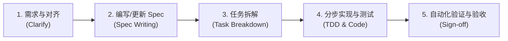

# 📐 项目规格说明书中心 (Specifications Hub)

欢迎使用 **规格驱动开发 (Spec-Driven Development, SDD)** 体系。

本目录是当前项目所有功能规格、架构设计、技术决策与实施方案的唯一权威信息源（Single Source of Truth）。在与 AI 编程助手协作时，通过结构化的 Spec 能有效消除需求歧义、杜绝 AI 幻觉，并确保工程质量与可验证性。

---

## 📁 目录组织结构

```text
specs/
├── README.md                      # 规范体系与使用指南（本文件）
├── templates/                     # 标准模板库
│   ├── 01_feature_spec.template.md        # 功能需求与契约规格书模板
│   ├── 02_technical_design.template.md    # 系统技术架构规格书模板
│   ├── 03_implementation_plan.template.md # 任务拆解与实施计划模板
│   └── 04_bug_fix_spec.template.md        # 缺陷排查与修复规格书模板
├── architecture/                  # 系统级全局架构设计规格
├── features/                      # 业务功能规格书存放目录
│   └── example_feature.spec.md
└── plans/                         # 具体实施阶段任务清单
    └── example_implementation.plan.md
```

---

## 🔄 核心开发工作流 (Standard Workflow)



### Step 1: 需求对齐 (Clarify)
- 在开始编码前，向 AI 助手描述想法或提出需求。
- 明确范围边界（In-Scope 与 Out-of-Scope）。

### Step 2: 撰写规格说明书 (Spec Writing)
- 从 `specs/templates/01_feature_spec.template.md` 复制一份到 `specs/features/<feature-name>.spec.md`。
- 与 AI 一道完善数据模型、接口契约与验收标准。
- 如有未决问题，使用 `[NEEDS CLARIFICATION]` 显式标出，切忌盲目臆测。

### Step 3: 任务拆解 (Task Breakdown)
- 基于 Spec 生成实施计划 `specs/plans/<feature-name>.plan.md`（参考 `03_implementation_plan.template.md`）。
- 将大功能拆解为 Phase 1 ~ Phase 5 的原子任务，每个任务清晰定义“验证方式”。

### Step 4: 渐进式实施 (Step-by-step Implementation)
- 遵循 **红-绿-重构 (TDD)** 循环，先写类型和测试，再写实现代码。
- 每完成一个任务，勾选对应 Checklist。

### Step 5: 验证验收 (Sign-off)
- 运行测试套件与类型检查：确保 0 报错。
- 逐条对照 Spec 中的验收场景（Acceptance Criteria）进行最终验收。
