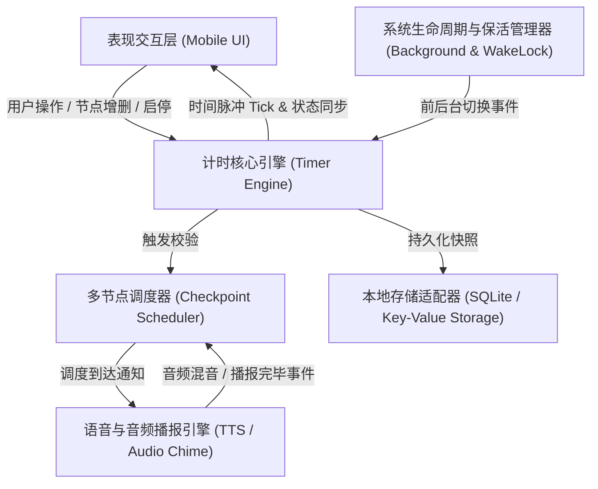
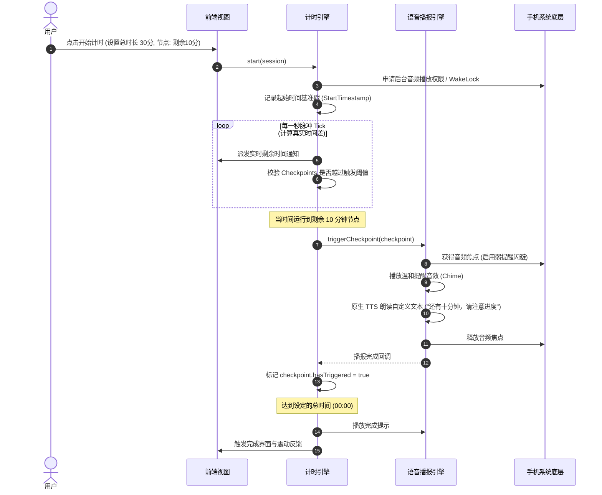

# SnoozeDD 移动端弱提醒计时与语音播报系统技术架构设计 (Technical Design Spec)

> **文档版本**：v0.1.0  
> **创建日期**：2026-11-17  
> **状态**：Draft  
> **设计人**：AI 架构助手 & 开发者  

---

## 1. 🏛 架构概述与设计目标 (Architecture Overview)

### 1.1 系统定位与核心价值
`SnoozeDD` 是一款运行在手机移动端的**多节点弱提醒专注与时段语音播报应用**。其核心解决的痛点是：用户在专注工作、学习、冥想或小憩时，传统的强刺激闹钟（全屏遮罩、高分贝刺耳响铃）会打断心流；而无声提醒又容易被遗忘。`SnoozeDD` 允许用户设定计时周期并在设定的多个中间时间节点（如“剩余10分钟”、“已进行半小时”），通过温和的自定义语音（TTS）或轻柔提示音自动进行弱提醒播报。

### 1.2 核心质量属性与移动端约束
- **后台保活与调度可靠性 (Reliability)**：移动端（Android / iOS）对后台进程休眠机制极其严格。系统必须通过“后台音频播放通道 (Background Audio Session)”或原生前台服务保障计时与到点播报精准触发。
- **低电量开销 (Power Efficiency)**：采用系统时钟差值比对算法（Delta Calculation），避免锁屏时高频轮询浪费 CPU 与电量。
- **离线即用与本地隐私 (Offline-First)**：MVP 阶段所有配置、模板与历史记录 100% 本地持久化，零网络依赖。

---

## 2. 🗺 系统分层架构图 (Architecture & Topology)



### 2.1 分层职责规范
1. **表现层 (Mobile UI)**：
   - 计时主表盘（剩余时长/进度环）。
   - 节点列表配置器（支持添加、编辑、开关多节点触发点与播报文案）。
   - 快捷预设模版（如：25分钟番茄钟、60分钟深度专注、20分钟小憩）。
2. **计时核心引擎 (Timer Engine)**：
   - 维持全局时钟状态（`IDLE`, `RUNNING`, `PAUSED`, `COMPLETED`）。
   - 基于时间戳差值（`TargetTimestamp - CurrentTimestamp`）抵御休眠导致的时间漂移。
3. **多节点调度器 (Checkpoint Scheduler)**：
   - 节点时间排序队列（升序/降序优先级队列）。
   - 到达目标时间戳时触发 `onCheckpointReached` 回调，防重复触发（防抖与状态锁）。
4. **语音与音频播报引擎 (Audio & TTS Engine)**：
   - 支持系统原生 TTS (Text-to-Speech) 朗读用户自定义文案。
   - 支持柔和提示音（Chime 音效）前置/后置播放。
   - 弱提醒策略：音频闪避（Ducking），降低其他背景音播放音量，播报完成后平滑恢复。
5. **系统生命周期与保活层 (Lifecycle & WakeLock)**：
   - 注册系统原生后台音频能力（iOS `UIBackgroundModes: audio`，Android `Foreground Service` 与电池优化忽略指引）。

---

## 3. 🗄 核心实体模型设计 (Domain Models)

```typescript
// 1. 播报节点实体
export interface Checkpoint {
  id: string;                      // 节点唯一 ID (UUID)
  triggerOffsetSeconds: number;    // 触发时间点偏移量（秒，例如正计时第 1800 秒，或倒计时剩余 600 秒）
  triggerType: 'elapsed' | 'remaining'; // 触发基准：已过去时间 / 剩余时间
  announcementText: string;        // 自定义播报文案（如：“还有十分钟，请注意时间分配”）
  chimeSoundId?: string;           // 可选的伴随提示音效
  isEnabled: boolean;              // 是否启用该节点
  hasTriggered: boolean;           // 本轮计时中是否已触发
}

// 2. 计时会话/预设配置
export interface TimerSession {
  id: string;
  name: string;                    // 会话名称，如“专注阅读”
  mode: 'countdown' | 'stopwatch'; // 倒计时 / 正向计时
  totalDurationSeconds: number;    // 总时长（倒计时专用，单位秒）
  checkpoints: Checkpoint[];       // 关联的提醒节点列表
  keepScreenOn: boolean;           // 计时中是否保持屏幕常亮
  gentleVolume: number;            // 播报音量 (0.0 ~ 1.0)
  createdAt: string;               // ISO 8601
  updatedAt: string;
}

// 3. 运行时计时器状态快照
export interface TimerRuntimeState {
  status: 'idle' | 'running' | 'paused' | 'completed';
  startedAt?: number;              // 启动基准毫秒时间戳
  pausedAt?: number;               // 暂停时的时间戳
  accumulatedSeconds: number;      // 累计有效耗时（秒）
  currentRemainingSeconds: number; // 当前剩余秒数（倒计时）
  currentSession: TimerSession;    // 当前运行的会话配置
}
```

---

## 4. 🔀 核心业务时序图 (Timer & Announcement Sequence)



---

## 5. 📱 移动端跨平台技术栈选型与评估 (Tech Stack Evaluation)

针对“手机端稳定运行”与“多节点语音弱提醒”核心诉求，评估主要方案：

| 维度 | 方案 A: Flutter (推荐) | 方案 B: React Native / Expo | 方案 C: Tauri Mobile 2.0 |
| :--- | :--- | :--- | :--- |
| **后台保活/音频** | 极其成熟 (`audio_service` + `flutter_tts`) | 成熟 (`expo-av` / `react-native-track-player`) | 尚在演进中，移动端后台插件需较多原生开发 |
| **手机端性能稳定性** | 原生引擎渲染，高流畅度，低卡顿 | 原生组件映射，良好 | WebView 封装，占用内存略高 |
| **离线 TTS 兼容性** | 插件稳定支持 iOS AVSpeech & Android TTS | 支持良好 | 需通过 FFI 自行调用原生插件 |
| **MVP 交付速度** | 组件库丰富，单工程跨 iOS/Android | 生态极大，JS 开发者友好 | Rust/Web 双技术栈，对纯移动端略复杂 |

> [!NOTE]
> 推荐采用 **Flutter** 或 **React Native (Expo)** 作为首选落地实现，保障后台播放与音频焦点处理的绝对稳定性。

---

## 6. ❓ 待澄清决策点 (Open Decisions)

- [ ] `[NEEDS CLARIFICATION]`：移动端技术栈偏好（Flutter vs React Native/Expo）。
- [ ] `[NEEDS CLARIFICATION]`：自定义播报语音，MVP 阶段是直接采用手机内置离线 TTS 发音，还是支持用户录制自己的声音？（推荐第一期采用系统内置离线 TTS，零占用存储且灵活）。
