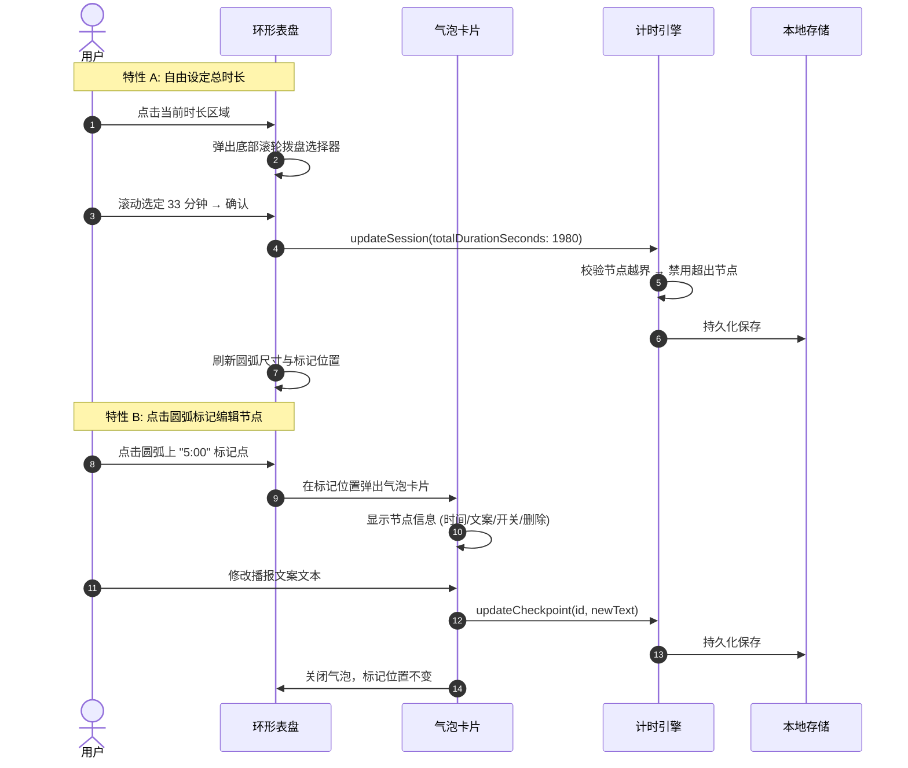

# 自由设置总时长 & 圆弧节点标记交互 功能规格书 (Feature Spec)

> **文档版本**：v0.1.0  
> **创建日期**：2026-11-17  
> **状态**：Completed  
> **负责人**：AI 架构助手 & 开发者  

---

## 1. 🎯 概述与业务目标 (Overview & Objectives)

### 1.1 背景与痛点
当前 MVP 仅提供 4 档固定预设时长（15/25/45/60 分钟），用户无法输入任意自定义时长（如 33 分钟、1 小时 10 分钟等），灵活性不足。同时，环形进度表盘仅展示计时进度弧线，用户无法直观看到自己设置的节点在时间线上的位置，也无法从表盘直接快速访问某个节点进行编辑。

### 1.2 核心目标 (Goals)
- [ ] **F-A：自由设置总时长** — 用户可通过滚轮拨盘选择器自由设定任意时长（1~180 分钟），取代固定预设按钮。
- [ ] **F-B：圆弧节点标记** — 倒计时圆环弧线上按比例渲染所有已配置 Checkpoint 的标记点（小圆点 + 时间标签），用户点击标记即弹出轻量气泡卡片就地编辑该节点。

### 1.3 非目标 (Non-Goals)
- 本次不做秒级精度设定（最小粒度为分钟）。
- 本次不支持拖拽标记点来修改节点触发时间（仅点击弹出编辑）。
- 本次不支持在正计时 (Stopwatch) 模式下显示圆弧标记（仅倒计时模式生效）。

---

## 2. 🚧 需求范围与边界 (Scope Boundaries)

### 2.1 包含范围 (In-Scope)

**特性 A — 自由设置总时长**
- [ ] 替换或增强现有预设 Chip 行，新增"自定义"入口
- [ ] 弹出底部滚轮拨盘选择器（CupertinoPicker 风格），包含时（0~2h）和分（0~59m）两列
- [ ] 选择器内预设常用快捷值（15/25/45/60/90/120 分钟），可一键选取
- [ ] 计时运行中禁用时长修改入口
- [ ] 选择后自动保存至本地持久化，下次启动恢复
- [ ] 总时长变更后，若现有 Checkpoint 超出新时长范围，向用户弹出提示并自动禁用超出节点

**特性 B — 圆弧节点标记与点击编辑**
- [ ] 在 `TimerDial` 的圆环弧线上，根据每个 Checkpoint 的 `offsetSeconds / totalDurationSeconds` 比例，定位渲染小圆点标记
- [ ] 标记旁显示简短时间标签（如 `5:00`、`15:00`），避免文字相互重叠（角度过近时合并或仅显示圆点）
- [ ] 已禁用 (isEnabled=false) 的节点标记以更淡/虚线样式区分
- [ ] 计时进行中已触发的节点标记变为完成态（如：✓ 或颜色变灰）
- [ ] 点击标记弹出轻量气泡卡片 (Popover)，显示：节点时间、播报文案、启用开关、编辑按钮、删除按钮
- [ ] 点击气泡的"编辑"按钮可就地修改播报文案文本
- [ ] 点击气泡的"删除"按钮删除该节点，标记即时消失
- [ ] 气泡的开关可就地切换节点的 `isEnabled` 状态

### 2.2 不包含范围 (Out-of-Scope)
> [!IMPORTANT]
> 以下特性明确排除，严禁 AI 擅自补充。
- 拖拽节点标记来调整节点时间
- 节点之间弧段的分色染色（不同节点区间不同颜色）
- 正计时 (Stopwatch) 模式下的圆弧标记渲染
- 时长设定精度低于分钟（不支持秒级设定）

---

## 3. 👥 用户角色与场景用例 (User Stories)

| 角色 | 期望操作 | 达成价值 |
| :--- | :--- | :--- |
| 用户 | 在计时开始前，通过滚轮拨盘设定 33 分钟的倒计时 | 不再受限于固定预设时长，自由掌控计时 |
| 用户 | 在圆弧上看到 "5:00" 和 "15:00" 两个标记节点 | 直观感知节点在整段时间中的位置分布 |
| 用户 | 点击圆弧上的 "5:00" 标记，弹出气泡修改播报文案 | 无需打开底部弹窗，就地快速编辑节点 |
| 用户 | 设定 20 分钟后，原有 30 分钟的节点被自动禁用并弹出提示 | 防止出现超时长范围的无效节点 |

---

## 4. 🛠 技术约束与依赖规范 (Technical Constraints)

- **技术栈**：Flutter (Dart)，与 MVP 保持一致
- **依赖库限制**：
  - 允许引入：无新增第三方依赖（使用 Flutter 内置 `CupertinoPicker` / `CustomPainter`）
  - 禁止引入：任何第三方的圆形 Slider 或圆盘组件库
- **代码复用**：
  - 复用现有 `Checkpoint` / `TimerSession` 数据模型及序列化
  - 复用现有 `StorageService` 持久化
  - 复用现有 `CheckpointListSheet` 作为完整编辑的后备入口

---

## 5. 🗄 数据结构变更 (Data Model Changes)

> [!NOTE]
> 本特性无需变更数据模型。`TimerSession.totalDurationSeconds` 已支持任意秒数，`Checkpoint` 结构无需修改。

---

## 6. 📋 核心业务规则 (Business Rules)

### 6.1 时长设定规则
1. **有效范围**：总时长范围为 1 分钟 ~ 180 分钟（60 ~ 10800 秒）。
2. **节点越界保护**：修改总时长后，系统遍历所有 `remaining` 类型节点，若 `offsetSeconds > newTotalDurationSeconds`，自动将该节点 `isEnabled` 设为 `false`，并弹出 SnackBar 告知用户。
3. **运行时锁定**：计时处于 `running` 状态时，时长选择入口置灰且不可交互。

### 6.2 圆弧标记定位规则
1. **角度映射**：节点角度 = `(offsetSeconds / totalDurationSeconds) × 360°`，`remaining` 类型从12点钟方向顺时针计算，`elapsed` 类型同理。
2. **标签防重叠**：当两个标记角度差小于 15° 时，仅保留圆点标记，隐藏时间文字标签。
3. **状态样式**：
   - 启用且未触发：主题色实心圆点 + 时间标签
   - 启用且已触发：灰色圆点 + ✓ 标记
   - 已禁用：半透明虚线风格圆点

### 6.3 气泡卡片交互规则
1. 同一时刻最多显示一个气泡卡片，点击其他标记或空白处关闭当前气泡。
2. 气泡卡片内编辑文案时使用 `TextField` 内联编辑，失去焦点自动保存。
3. 删除操作需二次确认（长按删除按钮或弹出迷你确认 Snack）。

### 6.4 交互流程时序图

---

## 7. ⚠️ 异常处理与边界用例 (Edge Cases)

| 编号 | 场景 | 处理策略 |
| :--- | :--- | :--- |
| E1 | 总时长设为 1 分钟，无法添加小于 1 分钟的 remaining 节点 | 添加节点对话框中筛选掉超出范围的选项，并提示"当前时长过短" |
| E2 | 节点数量 > 8 个，圆弧上标记过于密集 | 当标记角度差 < 15° 时隐藏文字标签，仅显示圆点 |
| E3 | 计时运行中 Checkpoint 被触发，圆弧标记需即时变灰 | 引擎 `onCheckpointTriggered` 回调中同步更新标记状态 |
| E4 | 用户在气泡编辑中途退出应用 | 利用 `TextField` 的 `onChanged` 实时暂存，恢复后无数据丢失 |
| E5 | 滚轮选中 0 分钟 | 拨盘最小值锁定为 1 分钟，禁止选择 0 |

---

## 8. ✅ 验收标准与 BDD 测试场景 (Acceptance Criteria)

### 场景 1: 自由设定任意时长
- **Given**：计时器处于 `idle` 状态
- **When**：用户打开滚轮选择器，设定 33 分钟
- **Then**：表盘显示 `33:00`，重启应用后时长保持 33 分钟

### 场景 2: 时长缩短后节点越界保护
- **Given**：已配置"剩余 30 分钟"的节点
- **When**：用户将总时长从 45 分钟改为 20 分钟
- **Then**：30 分钟节点自动禁用，SnackBar 提示"1 个节点已超出当前时长范围，已自动禁用"

### 场景 3: 圆弧标记正确定位
- **Given**：总时长 60 分钟，配置剩余 15 分钟和 30 分钟两个节点
- **When**：查看表盘
- **Then**：15 分钟节点标记位于 25% 弧长位置（从12点顺时针 90°），30 分钟节点位于 50% 位置（180°）

### 场景 4: 点击标记弹出气泡编辑
- **Given**：圆弧上显示 "5:00" 节点标记
- **When**：用户点击该标记
- **Then**：弹出气泡卡片，显示播报文案"还有五分钟"，可修改文案文字并即时保存

### 场景 5: 计时运行中标记状态变化
- **Given**：倒计时 10 分钟，配置剩余 5 分钟节点
- **When**：倒计时过半触发该节点
- **Then**：圆弧上该节点标记变为灰色完成态样式

---

## 9. ❓ 待澄清问题 (Open Questions)

- 无（所有设计决策已在开发对齐会议中确认）。
