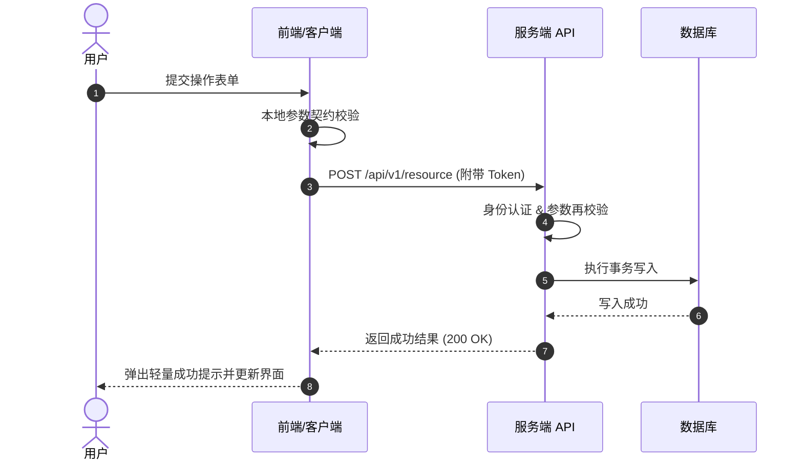

# [功能名称] 功能规格说明书 (Feature Spec)

> **文档版本**：v0.1.0  
> **创建日期**：YYYY-MM-DD  
> **状态**：Draft | Reviewing | Approved | In Progress | Completed  
> **负责人 / 作者**：[作者姓名/AI Agent]  

---

## 1. 🎯 概述与业务目标 (Overview & Objectives)

### 1.1 背景与痛点 (Background & Problem Statement)
- 简述该功能所要解决的实际业务问题或用户痛点。
- 为什么要在当前阶段实现此需求？

### 1.2 核心目标 (Goals)
- [ ] 目标 1：简明清晰，量化或可直接观察。
- [ ] 目标 2：例如将XX操作响应时间降至XXms以内。

### 1.3 非目标 (Non-Goals)
- 明确指出本次迭代**不追求**的目标，避免过度设计。

---

## 2. 🚧 需求范围与边界 (Scope Boundaries)

### 2.1 包含范围 (In-Scope)
- [ ] 核心功能点 1
- [ ] 核心功能点 2
- [ ] 必要的异常处理与降级提示

### 2.2 不包含范围 (Out-of-Scope)
> [!IMPORTANT]
> 明确排除的特性，禁止 AI 盲目发散或擅自补充。
- 明确本次不做的特性 1（例如：暂不支持第三方社交登录）
- 明确本次不做的特性 2（例如：暂不做批量导出功能）

---

## 3. 👥 用户角色与场景用例 (User Stories & Use Cases)

| 角色 (As a) | 期望行动 (I want to) | 达成价值 (So that) |
| :--- | :--- | :--- |
| 普通用户 | 在点击保存时看到自动草稿保存提示 | 避免误触关闭导致数据丢失 |
| 管理员 | 能够一键批量审核待办列表 | 提升日常审批效率 |

---

## 4. 🛠 技术约束与依赖规范 (Technical Constraints)

- **语言与框架**：`[例如：TypeScript 5.x / Next.js 14+ / React 18 / Node.js 20+]`
- **数据持久层**：`[例如：PostgreSQL / SQLite / Redis]`
- **依赖库限制**：
  - 允许引入的新依赖：`[例如：zod, date-fns]`
  - 禁止/限制引入：`[例如：禁止引入额外的庞大 UI 库，优先复用现有组件]`
- **代码复用要求**：
  - 工具函数优先复用：`[例如：src/utils/logger.ts, src/lib/api-client.ts]`

---

## 5. 🗄 数据结构与契约定义 (Data Models & Contracts)

### 5.1 数据模型 / 表结构 (Schema Definition)
```typescript
// 示例：核心数据实体或数据库模型定义
export interface ExampleEntity {
  id: string;              // 唯一标识 UUID
  title: string;           // 标题 (1-100字符)
  status: 'draft' | 'published' | 'archived';
  metadata?: Record<string, unknown>;
  createdAt: string;       // ISO 8601
  updatedAt: string;       // ISO 8601
}
```

### 5.2 API 契约规范 (API Contracts)

#### 接口 1: [接口名称]
- **Method & Route**: `POST /api/v1/resource`
- **认证方式**: Bearer Token | Cookie Session | 无需认证
- **Request Headers**:
  ```http
  Content-Type: application/json
  Authorization: Bearer <token>
  ```
- **Request Body**:
  ```json
  {
    "title": "示例标题",
    "status": "draft"
  }
  ```
- **Response Success (`200 OK` / `201 Created`)**:
  ```json
  {
    "code": 0,
    "message": "success",
    "data": {
      "id": "uuid-12345",
      "title": "示例标题",
      "status": "draft",
      "createdAt": "2026-11-17T12:00:00Z"
    }
  }
  ```
- **Response Error (`400 Bad Request` / `404 Not Found` / `500 Internal Error`)**:
  ```json
  {
    "code": 40001,
    "error": "INVALID_PARAMS",
    "message": "标题长度不能超过 100 字符"
  }
  ```

---

## 6. 📋 业务规则与逻辑时序 (Business Logic & Flow)

### 6.1 核心业务规则 (Business Rules)
1. **规则 1**：输入校验必须在前端与服务端双重验证（使用 Zod / Joi 等）。
2. **规则 2**：敏感数据操作须记录审计日志（操作人、时间、变更字段）。
3. **规则 3**：幂等性控制：客户端重复点击时，短时间内通过请求锁或 token 拦截防重复提交。

### 6.2 流程时序图 (Mermaid Sequence)


---

## 7. ⚠️ 异常处理与边界用例 (Edge Cases & Failure Handling)

| 场景序号 | 边界/异常场景 | 预期处理策略 |
| :--- | :--- | :--- |
| E1 | 网络超时或连接断开 | 前端显示重试按钮，保留用户已输入内容不丢失 |
| E2 | 数据库唯一键冲突 | 捕获冲突错误，返回友好错误码及提示文案 |
| E3 | 并发修改竞争 | 采用乐观锁或版本号校验，提示用户刷新最新状态 |
| E4 | 非法格式参数穿透 | 拦截在网关/验证中间件，不透传给数据库 |

---

## 8. ✅ 验收标准与 BDD 测试场景 (Acceptance Criteria & Tests)

> [!NOTE]
> AI 与测试人员基于本节标准编写单元测试、集成测试与 E2E 测试。

### 场景 1: [正常流程验收]
- **Given**：用户已登录且具备操作权限
- **When**：提交符合规范的有效参数
- **Then**：系统成功创建资源并返回 200，数据库新增对应记录

### 场景 2: [异常/拦截校验]
- **Given**：用户提交缺少必填字段的请求
- **When**：调用创建接口
- **Then**：系统拦截请求，返回 400 状态码与明确字段报错，不产生任何副作用

---

## 9. ❓ 待澄清问题与技术假设 (Open Questions & Assumptions)

- [ ] `[NEEDS CLARIFICATION]`：待产品经理/架构师确认的决策项。
- `[ASSUMPTION]`：当前技术假设，如假设已有身份认证中间件可以直接复用。
