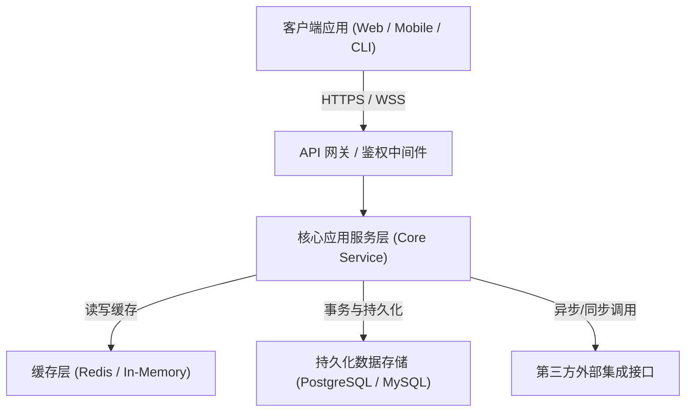
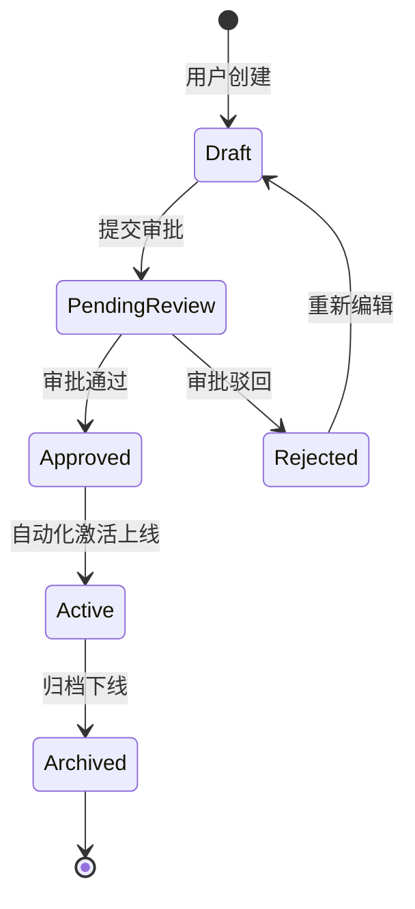

# [系统/模块名称] 技术架构与设计规格书 (Technical Design Spec)

> **文档版本**：v0.1.0  
> **创建日期**：YYYY-MM-DD  
> **状态**：Draft | In Review | Approved | Deprecated  
> **设计人 / 架构师**：[姓名/AI Agent]  

---

## 1. 🏛 架构概述与设计目标 (Architecture Overview)

### 1.1 系统定位与核心职责
- 描述该系统或核心模块在整体技术版图中的职责定位。

### 1.2 架构设计目标与质量属性
- **可用性与稳定性 (Availability)**：[如 SLA 目标、故障隔离机制]
- **扩展性 (Scalability)**：[未来如何横向扩容或插件化扩展]
- **可维护性与测试覆盖 (Maintainability)**：[代码模块解耦度、单测覆盖率目标]
- **性能指标 (Performance)**：[P99 延迟、吞吐量 QPS 要求]

---

## 2. 🗺 整体架构图与分层设计 (Architecture & Topology)

### 2.1 分层架构规范
- **表现层 (Presentation Layer)**：负责路由、DTO 校验、响应序列化。
- **业务领域层 (Domain/Business Layer)**：纯业务逻辑，不直接耦合底层协议。
- **基础设施/数据访问层 (Infrastructure/Data Layer)**：数据库交互、外部 HTTP 适配器。

---

## 3. 🧩 核心模块与组件拆解 (Component Breakdown)

| 模块名称 | 职责描述 | 输入/依赖 | 输出/产出 |
| :--- | :--- | :--- | :--- |
| `AuthModule` | 用户身份验证与权限鉴权 | 请求 Token / Header | 用户上下文上下文实体 |
| `BusinessService` | 执行核心业务算法与状态流转 | 验证后的 DTO | 领域事件 / 持久化结果 |
| `Repository` | 屏蔽底层存储细节的 CRUD 操作 | 查询条件 / 实体参数 | 持久化实体对象 |

---

## 4. 🔀 核心数据流与交互机制 (Data Flow & State Machine)

### 4.1 核心状态机设计 (State Machine)

---

## 5. 🛡 安全、权限与合规约束 (Security & Compliance)

- **身份认证与鉴权 (AuthN / AuthZ)**：采用何种机制（JWT、Session、RBAC、ABAC）。
- **数据传输与加密 (Encryption)**：敏感字段（密码、手机号、凭证）的哈希或加解密算法。
- **输入过滤防注入**：SQL 注入防范、XSS 防护、CSRF 机制、Rate Limiting 速率限制。
- **审计追踪**：关键变更的操作日志留存机制。

---

## 6. 🚀 部署架构与运维监控 (Deployment & Observability)

- **运行环境**：Node.js / Docker 容器 / Serverless / Kubernetes。
- **日志规范**：JSON 结构化日志，包含 `traceId`, `userId`, `timestamp`, `level`。
- **指标监控**：健康检查探针 `/healthz`、Metrics 暴露路径。
- **回滚预案 (Rollback Plan)**：数据库迁移向前兼容策略与回滚步骤。
